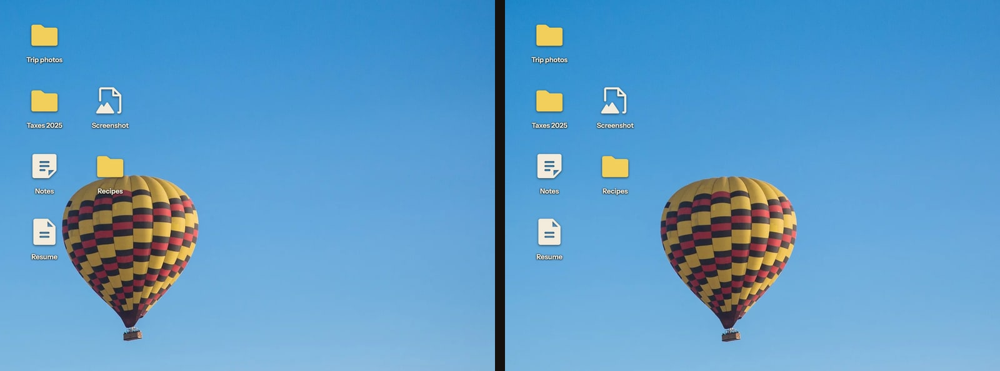

# Scooch

Moves the desktop wallpaper so icons do not cover the subject of the picture. macOS, Windows and Linux.



## Install

macOS and Linux

```sh
curl -LsSf https://sohanbhat.me/scooch/install.sh | sh
```

Windows

```powershell
irm https://sohanbhat.me/scooch/install.ps1 | iex
```

Then run `scooch`.

## Commands

| Command | What happens |
|---|---|
| `scooch` | Turns Scooch on. Run it again for status. |
| `scooch use` | Picks a different picture. |
| `scooch flip` | Allows flipping the picture when that clears the icons. |
| `scooch off` | Restores the wallpaper and removes the login item. Desktops and screens that are not showing are restored the next time they show. |
| `scooch doctor` | Checks that the desktop can be read. |

## How it works

1. Find the subject with a saliency map from color and contrast. No model files.
2. Read the icon rectangles from the desktop.
3. Search crop, pan and a per-axis warp that only stretches columns and rows with no subject in them. Zoom is used only when a slide cannot clear the icons.
4. Render one image and set it as the normal wallpaper.

One background process does this. It is event driven with no timer and no window, so it uses no CPU between changes. The engine, the daemon and each desktop adapter are described in [docs/DESIGN.md](docs/DESIGN.md).

## Status

| System | Status |
|---|---|
| macOS 14 and 15 | Tested on a real Mac |
| Windows 10 and 11 | Written, not yet run on Windows |
| Linux with GNOME, KDE Plasma, Xfce, Cinnamon or MATE | Written, not yet run on Linux |

## Limits

- A subject that touches the screen edge under the icons cannot slide clear, because there is no picture beyond that edge. `scooch flip` clears it by mirroring.
- The wallpaper must be a picture file. A slideshow, a video wallpaper or a plain color is left alone until a picture is picked with `scooch use`.
- macOS asks once for permission to read icon positions from Finder. Colors outside sRGB lose a little saturation in the rendered picture.
- GNOME, Cinnamon and MATE use one picture for every monitor, so it is arranged for the main one.
- On KDE an icon move can take up to 10 seconds to arrive, because Plasma saves icon positions on a timer.

## Build

```sh
cargo install --path crates/scooch
```

To remove it, run `scooch off` and delete the program.

MIT license. Test photos and their sources are in [assets/photos/SOURCES.md](assets/photos/SOURCES.md).
