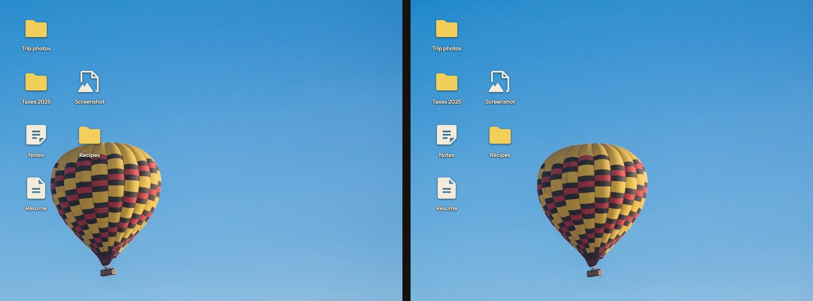

# Scooch

Moves the desktop wallpaper so icons do not cover the subject of the picture. macOS, Windows and Linux.



## Install

| System | Download |
|---|---|
| macOS | [Scooch.dmg](https://github.com/sohan-bhat/scooch/releases/latest/download/Scooch.dmg) |
| Windows | [Intel or AMD](https://github.com/sohan-bhat/scooch/releases/latest/download/Scooch-Setup-x64.exe), [Arm](https://github.com/sohan-bhat/scooch/releases/latest/download/Scooch-Setup-arm64.exe) |
| Linux, Intel or AMD | [.deb](https://github.com/sohan-bhat/scooch/releases/latest/download/scooch_amd64.deb), [.rpm](https://github.com/sohan-bhat/scooch/releases/latest/download/scooch.x86_64.rpm), [AppImage](https://github.com/sohan-bhat/scooch/releases/latest/download/Scooch-x86_64.AppImage) |
| Linux, Arm | [.deb](https://github.com/sohan-bhat/scooch/releases/latest/download/scooch_arm64.deb), [.rpm](https://github.com/sohan-bhat/scooch/releases/latest/download/scooch.aarch64.rpm), [AppImage](https://github.com/sohan-bhat/scooch/releases/latest/download/Scooch-aarch64.AppImage) |

Then open Scooch. The first open turns Scooch on.

The macOS app is not notarized, so the first open needs Open Anyway in System Settings under Privacy and Security. The Windows setup is not signed, so SmartScreen shows a warning once.

The Windows installer and the Linux packages also add the `scooch` command. The AppImage adds `scooch` to ~/.local/bin once Scooch is on. For the command on macOS, or the command alone, run

```sh
curl -LsSf https://sohanbhat.me/scooch/install.sh | sh
```

or on Windows

```powershell
irm https://sohanbhat.me/scooch/install.ps1 | iex
```

## Commands

| Command | What happens |
|---|---|
| `scooch` | Turns Scooch on. Run it again for status. |
| `scooch use [picture]` | Switches the picture on every screen. With no picture a picker opens. |
| `scooch flip` | Lets Scooch flip the picture when that clears the icons, or turns that off. Off by default. |
| `scooch scenery` | Turns the clouds and islands around the icons on or off. On by default. |
| `scooch glide` | Turns the slide into the new place on or off, on macOS and Windows. On by default. |
| `scooch predict` | Turns the quick drop on or off. On Xfce and Plasma 5 under X11 the picture then moves at the drop of a single icon. On by default. |
| `scooch status` | Shows whether Scooch is on, the picture and the icon count. |
| `scooch off` | Restores the wallpaper and removes the login item. Desktops and screens that are not showing are restored the next time they show. |
| `scooch doctor` | Checks permissions and the desktop. |
| `scooch render` | Renders one picture to a file without touching the wallpaper. |

The app window has the same switches, named Slide, Clouds, Flip and Quick drop.

## How it works

1. Find the subject with a saliency map from color and contrast. No model files.
2. Read the icon rectangles from the desktop.
3. Search crop, pan and a per-axis warp that only stretches or squeezes columns and rows with no subject in them. Zoom is used only when moving the picture cannot clear the icons.
4. With scenery on, add clouds on a blue sky or sand islands on blue water around the icons, kept off the subject.
5. Render one image and set it as the normal wallpaper. On macOS and Windows the old picture slides into the new one over 450 ms.

One background process does this work. It is event driven and uses no CPU at rest. The slide runs in a helper process that exits 30 s after its last move. The engine, the daemon and each desktop adapter are described in [docs/DESIGN.md](docs/DESIGN.md).

## Status

| System | Tested on |
|---|---|
| macOS | A real Mac on macOS 15.5. GitHub runners on macOS 15 for Apple silicon and Intel, with the login item, two Spaces, the slide and the app from the disk image |
| Windows | GitHub runners on Windows Server 2025, build 26100, with the Windows 11 desktop, and on Windows Server 2022, build 20348, with the Windows 10 desktop, at 100% and 150% scaling. The installer on Server 2025 and on Windows 11 for Arm |
| Linux | Real sessions on GitHub runners of GNOME 46 with Desktop Icons NG under Wayland, KDE Plasma 5.27 and 6.7 under X11 and 6.8 under Wayland, and Xfce 4.18 and 4.20, Cinnamon 6.0 and 6.8 and MATE 1.26 and 1.28 under X11. Xfce also at 200% scaling. The .deb, .rpm and AppImage for Intel and Arm |

Two monitors are tested on Plasma 6.7, GNOME 46 and MATE 1.26 with an icon moved onto the second monitor, and on Xfce 4.18 and 4.20 and Plasma 6.8 under Wayland with a picture set on each.

### Not yet tested

- More than one monitor on macOS, Windows, Plasma 5 and Cinnamon.
- A Mac display at scale 2.
- Dragging an icon on Plasma under Wayland, and onto a second monitor on Xfce.
- GNOME under X11.
- The slide from a real mouse or trackpad, at 60 frames a second on real hardware, and on several monitors at once.
- A monitor unplugged while Scooch is on, on real hardware.

## Limits

- A subject that touches the screen edge under the icons cannot slide clear on a screen with the same shape as the picture, because there is no picture beyond that edge. `scooch flip` lets Scooch mirror the picture to clear the subject.
- The wallpaper must be a picture file. A slideshow, a video wallpaper or a plain color is left alone until a picture is picked with `scooch use`.
- On macOS choose Allow once so Scooch can read icon positions from Finder. Colors outside sRGB are clipped in the rendered picture.
- GNOME, Cinnamon and MATE use one picture for every monitor, so Scooch arranges the picture for the main one.
- Linux has no slide. The new picture replaces the old one at once.
- On GNOME, Cinnamon, MATE and Plasma 6 under X11 the picture moves a median of 0.1 to 0.25 s after the drop. On Xfce and Plasma 5 under X11 Scooch guesses where a single dragged icon lands and moves the picture at the drop. After other moves there, such as several icons at once, the picture moves once the desktop saves its positions, about 1 to 2 s later. On Plasma under Wayland the picture moves when Plasma saves, which is not timed yet.
- On Windows a change of icon size, or icons moved by another program, is not noticed until the next drag or click on the desktop.
- Clouds go only on a blue sky that reaches the top of the picture, and islands only on teal or blue water. Other pictures get no scenery.
- The app does not update itself. A new version is a new download.

## Remove

Moving the app or the AppImage to the Trash turns Scooch off and puts the wallpaper back. The Windows uninstaller does the same, and so does removing the .deb or .rpm while you are logged in to your desktop. For a command install, run `scooch off` and delete the program.

## Build

```sh
cargo install --path crates/scooch
```

MIT license. Test photos and their sources are in [assets/photos/SOURCES.md](assets/photos/SOURCES.md).

Built by [Sohan Bhat](https://sohanbhat.me/).
